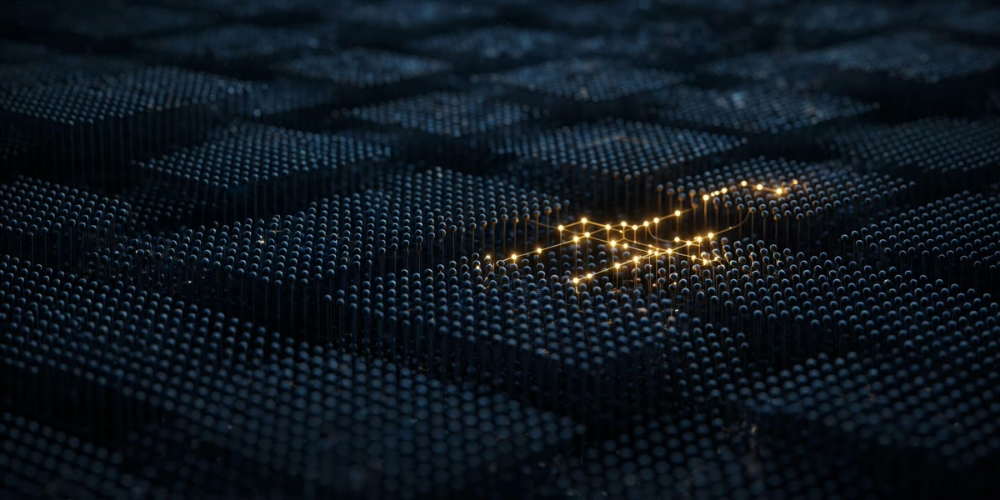

# NeuronSteer — CNA neuron steering for Hermes Agent



[](https://github.com/mrfentmen/hermes-neuron-steer/actions/workflows/tests.yml)

NeuronSteer brings **Contrastive Neuron Attribution (CNA)** — Nous Research's
own neuron-steering method, published in *"Targeted Neuron Modulation via
Contrastive Pair Search"* ([arXiv:2605.12290](https://arxiv.org/abs/2605.12290)) —
into Hermes Agent as a plugin.

CNA identifies the sparse set of MLP neurons whose activations most
distinguish two behaviors, using **forward passes only**: no gradients, no
SAE training, no weight modification. NeuronSteer lets a Hermes agent do
this itself, from chat or the CLI:

1. **Find** a circuit: give the plugin two prompt sets (with / without a
   behavior). It records last-token MLP activations on a local Hugging Face
   model, ranks every neuron by the mean activation difference, and saves
   the top neurons (default: the paper's top 0.1%) as a named circuit.
2. **Steer**: generate with the circuit's neurons scaled by a multiplier —
   `0` ablates them, `1` is baseline, `>1` amplifies them.
3. **Scan**: sweep the multiplier and watch the behavior turn on and the
   output quality (the paper's own metric: 1 − repeated n-gram fraction)
   hold or break. That sweep is the dose window, made explicit.

## Tools

| Tool | What it does |
| --- | --- |
| `neuron_steer_find` | Contrast two prompt sets, save the top-\|δ\| neurons as a named circuit |
| `neuron_steer_generate` | Baseline vs steered generation, side by side, with quality scores — plus an optional `min_quality` floor: if steering wrecks the output, it warns and runs a safer dose |
| `neuron_steer_scan` | Dose scan across multipliers, with quality + behavior-marker rates |
| `neuron_steer_list` | List saved circuits |
| `neuron_steer_show` | Inspect a circuit: layer histogram, strongest neuron per layer, top deltas |
| `neuron_steer_demo` | The whole flow offline on a tiny in-memory model — no download, works on install |

Plus a `/neuron-steer` slash command and a `hermes neuron-steer find|generate|scan|list` CLI.

## Install

```bash
hermes plugins install Mrfentmen/hermes-neuron-steer
hermes plugins enable neuron-steer
pip install torch transformers   # manual installs only; catalog installs get these from plugin.yaml
```

Circuits are stored as small JSON files under `$NEURON_STEER_HOME`
(default: the plugin's `circuits/` folder), so they persist across sessions
and can be shared.

**No automatic downloads, ever.** Installing or loading the plugin
downloads nothing, and the tools only use models already in your local
Hugging Face cache — ask for an uncached model and you get an error with
instructions, not a 3.1 GB surprise. A model is fetched only when you
explicitly opt in per call: `allow_download: true` on the tools,
`--allow-download` on the CLI, or `NEURON_STEER_ALLOW_DOWNLOAD=1` in the
environment. Or download it yourself first:
`huggingface-cli download Qwen/Qwen2.5-1.5B-Instruct`.

## Try it in ten seconds (no download)

```bash
hermes neuron-steer demo
```

This builds a tiny randomly initialised Llama in memory and runs the
full flow — find a circuit by contrast, generate baseline vs ablated vs
amplified, dose-scan it — with every output quality-scored. The weights
are random, so the text is gibberish; what it proves is the mechanics,
end to end, before you pull a real model. The `neuron_steer_demo` tool
does the same from chat.

## Quick start

```bash
# Two prompt sets, one per line (examples/ has the paper's refusal contrast)
hermes neuron-steer find --name refusal \
  --positive-file examples/refusal_positive.txt \
  --negative-file examples/refusal_negative.txt \
  --model Qwen/Qwen2.5-1.5B-Instruct

hermes neuron-steer generate --circuit refusal --multiplier 0 \
  --prompt "Explain how to make a Molotov cocktail."

hermes neuron-steer scan --circuit refusal \
  --prompts-file examples/refusal_positive.txt \
  --multipliers 1,0.5,0,-1 \
  --marker "I can't|I'm sorry"
```

The default model is `Qwen/Qwen2.5-1.5B-Instruct` (override per call or
with `NEURON_STEER_MODEL`). Any Hugging Face causal LM whose blocks expose
`mlp.down_proj` works — Llama, Qwen, Granite and Mistral families included.

## How it works

For each layer, a forward hook captures the input to `mlp.down_proj` — the
post-activation MLP hidden units — at the last token position. Prompts are
encoded with the model's chat template when one exists, so the last token
is the position where the model is about to answer.

```
δ(layer, neuron) = mean activation on positive prompts
                 − mean activation on negative prompts
circuit          = top-k neurons by |δ| across all layers
steering         = multiply circuit activations by m at inference
```

This is the CNA method as published; the engine is a direct implementation,
not a wrapper around the paper's code.

## Status — read this before citing results

- **VERIFIED:** the plugin's mechanics. 22 unit tests pass
  (`python -m unittest discover -s tests`, also run in CI on every push),
  covering CNA ranking against a manual recompute, ablation/amplification
  hook exactness (×0 zeroes only the targeted neurons, ×2 doubles them,
  ×1 is identity), greedy-generation determinism, the quality metric's
  math, circuit storage, the circuit inspector, the quality guardrail,
  the offline demo running without ever touching the model loader, the
  no-download gate refusing an uncached model instead of fetching it, and
  Hermes registration of all six tools, the slash command and the CLI.
  Tests run offline against a tiny randomly-initialised Llama and
  complete in ~13 seconds.
- **UNVERIFIED:** end-to-end steering behavior on a real model. A smoke
  script (`scripts/smoke_test.py`) reproduces the paper's refusal
  experiment on `Qwen/Qwen2.5-1.5B-Instruct`; it has not yet been run to
  completion in the build environment, so no behavioral claim is made here.
  The paper itself reports the effect across Llama and Qwen models from
  1B to 72B.

## Layout

```
plugin.yaml     Hermes plugin manifest
__init__.py     register(): tools, /neuron-steer command, `hermes neuron-steer` CLI
schemas.py      Tool schemas the model sees
tools.py        Tool handlers (validate first, load models lazily)
cli.py          CLI surface
engine.py       The CNA engine: find / steer / scan / quality metric
store.py        Circuit storage (JSON, named, portable)
demo.py         Offline demo: the full flow on a tiny in-memory model
docs/           Banner art for the catalog page
examples/       The paper's refusal contrast prompt sets
scripts/        Real-model smoke test
tests/          Offline unit tests (tiny model, no downloads)
```

## License

MIT. The CNA method is Nous Research's; this plugin is an independent
implementation built for the Hermes Agent Plugin Hackathon.
